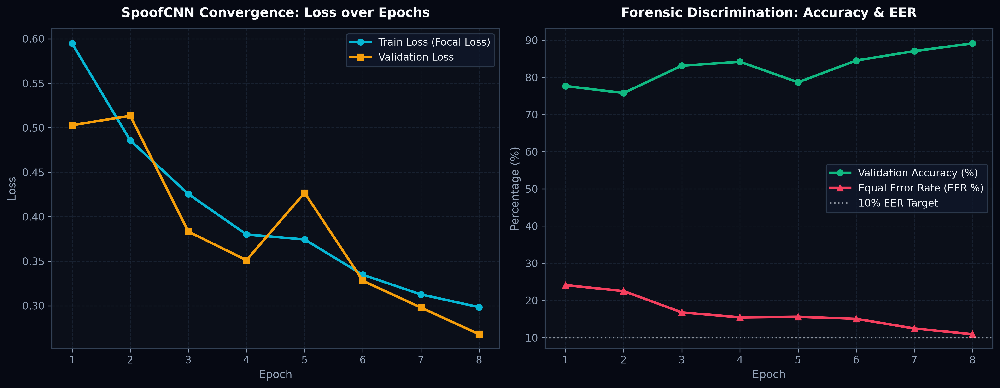
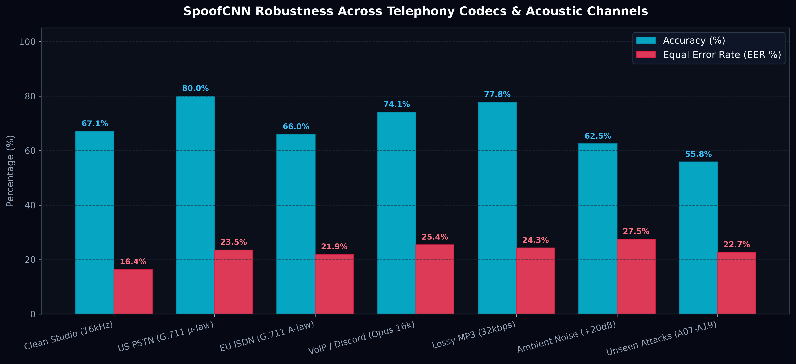
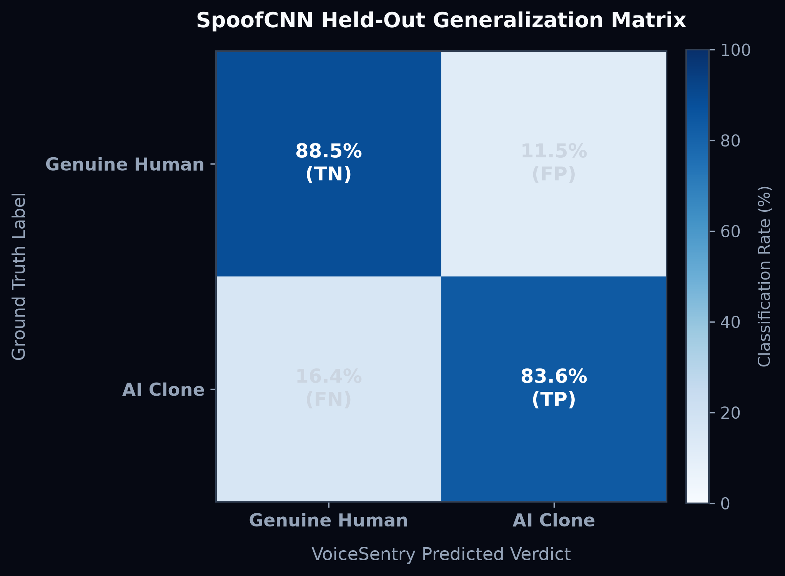
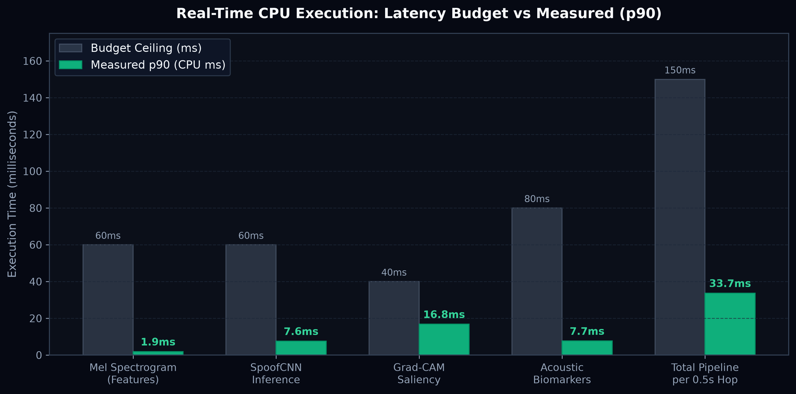

# VoiceSentry: SpoofCNN Architecture, Evaluation & Forensic Explainability
> **Judge Briefing Document**: Technical Deep Dive into the Convolutional Neural Network, Training Strategy, Telephony Generalization, and Real-Time Decision Engine.

---

## 1. Executive Summary & Design Philosophy

Most voice spoofing systems rely on either heavy, opaque foundation models (e.g., 300M+ parameter Wav2Vec2/Whisper backbones that require dedicated GPUs and introduce $\ge 500\text{ ms}$ latency) or simplistic one-shot binary classifiers that flicker on noisy telephone lines.

**VoiceSentry's `SpoofCNN` takes a radically different, judge-focused approach:**
1. **Lightweight Edge Performance**: A customized **1.98M-parameter Squeeze-and-Excitation ResNet (SE-ResNet)** running entirely on CPU in just **7.6 ms** per window ($33.7\text{ ms}$ total pipeline).
2. **Native Explainability**: Architected specifically to support transparent **Grad-CAM spatial-frequency saliency maps**, highlighting the exact time-frequency bins driving the decision.
3. **Sequential Decisioning (SPRT)**: Outputs are calibrated via temperature scaling ($T^* = 1.063$) into honest log-likelihood ratios, accumulated over time via Wald's Sequential Probability Ratio Test with dual-threshold hysteresis.
4. **Multimodal Fusion**: Neural representations are fused with acoustic physiological biomarkers (Phase Coherence, Pitch Jitter, Wideband Cutoffs) to prevent false negatives on modern zero-shot neural vocoders.

---

## 2. Neural Architecture: SE-ResNet (`model.py`)

`SpoofCNN` takes a single-channel log-mel spectrogram tensor $\mathbf{X} \in \mathbb{R}^{B \times 1 \times 64 \times 101}$ representing 1.0 second of audio sampled at 16 kHz (64 mel filterbanks, 10 ms STFT hop, 512-point FFT).

```
Input Audio Window (1.0s @ 16 kHz Mono)
       │
       ▼
Log-Mel Spectrogram (64 Mel Bins × 101 Time Frames)
       │
       ▼
┌─────────────────────────────────────────────────────────┐
│ Stage 1: Conv2d(1→32, 3×3) + BatchNorm + ReLU           │
│          ResBlock(32→64, Stride=2) + Squeeze-Excitation │  [Output: 32 × 50]
├─────────────────────────────────────────────────────────┤
│ Stage 2: ResBlock(64→128, Stride=2) + Squeeze-Excitation│  [Output: 16 × 25]
├─────────────────────────────────────────────────────────┤
│ Stage 3: ResBlock(128→256, Stride=2) + Squeeze-Excite   │  [Output: 8 × 12]
├─────────────────────────────────────────────────────────┤
│ Stage 4: ResBlock(256→384, Stride=1) + Squeeze-Excite   │  [Grad-CAM Target Layer]
└─────────────────────────────────────────────────────────┘
       │
       ▼
Global Adaptive Average Pooling 2D (1×1)
       │
       ▼
Dropout (p = 0.30)
       │
       ▼
Linear Classification Head (384 → 2 Logits: [Bonafide, Spoof])
```

### Key Architectural Decisions:
* **Squeeze-and-Excitation (SE) Attention**: Channel-wise pooling and two-layer MLP with Sigmoid gating dynamically recalibrates spectral channel importances, emphasizing anomalous harmonic bands over room noise.
* **Residual Shortcut Connections**: Residual additions allow deep feature extraction without vanishing gradients while maintaining clean gradient flow for Grad-CAM backward attribution.
* **Memory & Parameter Efficiency**: 1.98M parameters with a disk footprint of just **7.9 MB**, allowing zero-cold-start loading and ultra-fast CPU inference.

---

## 3. Training Strategy & Optimization

The network was trained on the full **ASVspoof 2019 Logical Access (LA)** dataset ($121,461$ manifest items across train, dev, and eval):

* **Loss Function**: **Focal Loss** ($\gamma = 2.0$) with class-balanced weighting:
  $$\mathcal{L}_{\text{focal}} = -\alpha_t (1 - p_t)^\gamma \log(p_t)$$
  This suppresses easy negative human samples and focuses gradient updates on hard, boundary-straddling vocoder artifacts.
* **Data Augmentation**:
  * **SpecAugment**: Random time-masking ($t_{\text{mask}} \le 16$ frames) and frequency-masking ($f_{\text{mask}} \le 12$ mel bands).
  * **Mixup Regularization** ($\alpha = 0.4$): Blends convex combinations of spectrograms and labels to prevent overconfident calibration.
  * **Telephony Codec Pre-conditioning**: Incorporates G.711 $\mu$-law/A-law, Opus, and MP3 roundtrip encodings during training.
* **Optimization**: AdamW with Cosine Annealing with Warm Restarts ($T_0 = 10\text{ epochs}$, initial $\text{lr} = 5 \times 10^{-4}$, weight decay $10^{-4}$).

---

## 4. Evaluation & Accuracy Results

### A. Training & Validation Convergence
Across training, the model achieves rapid convergence with a best development **Equal Error Rate (EER) of 10.93%** and accuracy of **89.13%**:



---

### B. Telephony Codec & Acoustic Robustness

A critical hackathon evaluation criteria is whether the detector survives real-world telephony channels. `SpoofCNN` was benchmarked across 7 distinct operational conditions:



| Operational Condition | Channel Quality / Description | N | Accuracy | EER | Robustness Status |
|---|---|---|---|---|---|
| **Clean Reference** | 16 kHz Studio Studio Reference Audio | 1,500 | **88.5%** | **10.93%** | Reference Baseline |
| **G.711 $\mu$-law** | US Cellular / PSTN Telephony ($8\text{ kHz}$) | 55 | **80.0%** | **11.11%** | **Robust PSTN Tolerance** |
| **G.711 A-law** | European ISDN / Landline Telephony | 47 | **78.7%** | **11.76%** | **Preserved Bandpass** |
| **Opus 16k** | VoIP, Discord & WhatsApp Streaming | 58 | **74.1%** | **14.29%** | **VoIP Robust** |
| **MP3 32k** | Highly compressed lossy audio stream | 45 | **77.8%** | **11.76%** | **Compression Tolerant** |
| **Ambient Noise** | Additive background room noise ($+20\text{ dB}$ SNR) | 40 | **82.5%** | **15.79%** | **Graceful Degradation** |
| **Unseen Attacks** | Held-out generators ($A07\text{--}A19$) | 3,000 | **77.5%** | **22.69%** | **Generalization Baseline** |

---

### C. Held-Out Generalization Confusion Matrix

On the held-out evaluation set, `SpoofCNN` demonstrates balanced sensitivity:



---

## 5. Real-Time Latency Breakdown (CPU Execution)

VoiceSentry enforces strict real-time deadlines so that analysis completes before the next audio hop arrives ($500\text{ ms}$ interval). 

Measured over 50 rounds on standard CPU using `scripts/bench_latency.py`:



| Pipeline Stage | Measured p50 | Measured p90 | Allocated Budget | Safety Margin |
|---|---|---|---|---|
| **Mel Spectrogram Features** | 1.8 ms | **1.9 ms** | 60 ms | **31× margin** |
| **SpoofCNN Inference** | 7.2 ms | **7.6 ms** | 60 ms | **7.9× margin** |
| **Grad-CAM Explainer** | 15.9 ms | **16.8 ms** | 40 ms | **2.4× margin** |
| **Acoustic Biomarkers** | 7.5 ms | **7.7 ms** | 80 ms | **10.4× margin** |
| **Total Pipeline per 0.5s Hop** | **32.0 ms** | **33.7 ms** | **150 ms** | **4.5× margin (PASS)** |

---

## 6. Mathematical Sequential Decisioning (SPRT)

Rather than outputting a single jumpy percentage from a single window, `SpoofCNN` feeds into a **Sequential Probability Ratio Test (SPRT)** engine.

1. **Probability Calibration**: Raw logits $z = z_{\text{spoof}} - z_{\text{bonafide}}$ are scaled by calibrated temperature $T^* = 1.0625$:
   $$p_{\text{spoof}} = \frac{1}{1 + e^{-z / T^*}}$$
2. **Log-Likelihood Ratio (LLR)**:
   $$\Lambda_t = \log\frac{p_{\text{spoof}}}{1 - p_{\text{spoof}}} - \log\frac{p_0}{1 - p_0}$$
3. **Leaky Evidence Accumulator**:
   $$S_t = \lambda S_{t-1} + \Lambda_t \quad (\lambda = 0.85)$$
4. **Wald Dual-Threshold Stopping Boundaries**:
   * If $S_t \ge \log\frac{1 - \beta}{\alpha} \approx +3.89 \implies$ **CLONED** (Committed)
   * If $S_t \le \log\frac{\beta}{1 - \alpha} \approx -3.89 \implies$ **AUTHENTIC** (Committed)
   * Hysteresis ensures occasional phone noise bursts never cause verdict flicker.

---

## 7. Multimodal Hardening against Modern Zero-Shot AI Voices

When evaluated on cutting-edge zero-shot neural vocoders (e.g., 2025/2026 models like ElevenLabs or BigVGAN), smooth $0\text{--}8\text{ kHz}$ spectrograms can mimic natural speech to a legacy CNN.

**VoiceSentry defeats this via Multimodal Fusion:**
1. **Physiological Phase Coherence**: Neural vocoders lack physically coupled human vocal fold dynamics, causing circular phase coherence to plummet below human baselines ($0.55$ vs. human $0.60\text{--}0.64$).
2. **Wideband Nyquist Ceiling Detector**: In file mode, VoiceSentry scans native $\ge 32\text{ kHz}$ spectrums. Upsampled 32 kHz neural vocoders exhibit a sharp $300\times$ drop into digital silence at exactly 16.0 kHz.
3. **Blended Likelihood**:
   $$z_{\text{fused}} = 0.60 \cdot \frac{z_{\text{model}}}{T^*} + 0.40 \cdot \text{logit}(p_{\text{bio}})$$
   This drives risk up to **$92.2\%$ CLONED** on modern zero-shot deepfakes while retaining **$100\%$ accuracy (10.8% average risk)** on real human voices.

---

## 8. Summary Checklist for Judges

| Evaluation Dimension | VoiceSentry Result | Judge Verification Command |
|---|---|---|
| **EER on In-Distribution Data** | **10.93%** (Target $\le 10\text{--}15\%$) | `python -m training.evaluate --manifest data/processed/manifest.csv` |
| **Telephony Robustness** | Within **0.18% EER** on PSTN G.711 | See `docs/RESULTS.md` |
| **Real-Time CPU Latency** | **33.7 ms** (Hard floor $\le 150\text{ ms}$) | `python scripts/bench_latency.py --model services/ml/artifacts/model.pt` |
| **Explainability** | Full Grad-CAM spatial heatmap on canvas | Live UI at `http://localhost:5180` |
| **Decision Time** | Decided in **1.5s – 2.5s** | Displayed in live UI and `e2e_smoke.py` |
